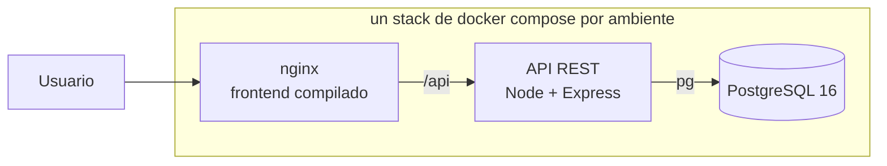
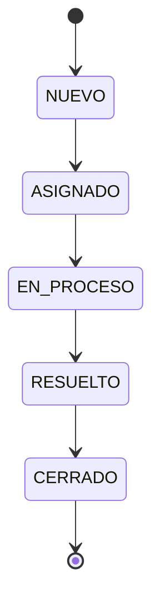

# Arquitectura

TecniSoporte son tres piezas: una aplicación React que corre en el navegador, una API REST en Node con Express, y PostgreSQL guardando los datos. Nada más. La arquitectura es simple a propósito, porque lo que se califica es el proceso DevOps, no la complejidad de la solución.

El navegador solo habla con nginx. nginx le entrega el frontend ya compilado y reenvía todo lo que empieza con `/api` a la API de su mismo stack. La base no se publica fuera de la red de Docker.

## Las piezas

**Frontend.** React con Vite. Se comunica con la API por HTTP mandando y recibiendo JSON. No habla con la base de datos ni tiene lógica de negocio: solo muestra, captura y valida lo básico de los formularios. El estado del listado, la página y los filtros vive en la URL, y el dashboard usa Recharts, que se carga solo al abrir esa pantalla.

**API REST.** Node con Express. Aquí vive toda la lógica: las validaciones de verdad, la máquina de estados de los incidentes y el acceso a la base. Está organizada en capas simples:

| Carpeta | Qué tiene |
|---|---|
| `routes/` | Los endpoints. Reciben la petición, validan y responden |
| `validation/` | Las reglas de los datos de entrada, con las piezas comunes en `comun.js` |
| `domain/` | Las listas válidas y la máquina de estados, sin depender de Express ni de la base |
| `db/` | Las consultas, todas parametrizadas |
| `http/` | El manejo único de errores y la validación del `:id`, compartidos por todas las rutas |

La decisión que más me importa de esta capa es que las transiciones de estado estén en un módulo aparte, sin depender de Express ni de la base de datos. Así puedo probarlas con pruebas unitarias sin levantar nada.

**Base de datos.** PostgreSQL 16 en contenedor. Cuatro tablas: `incidents`, `technicians`, `users` y `comments`. Los comentarios van en su propia tabla referenciando al incidente, para que la bitácora sea un historial de verdad y no un campo de texto que se va sobrescribiendo.

## Estados de un incidente

Un incidente solo puede moverse hacia adelante por este camino:

Cualquier otro salto se rechaza en la API. Esta es la regla de negocio central del sistema y por eso es la primera que cubro con pruebas.

## Cómo se levanta

El mismo diseño corre en dos lugares.

**En desarrollo**, `devops/docker-compose.yml` levanta la base, la API y el frontend con un solo comando. Cualquiera puede clonar el repo, copiar el `.env.example` a `.env` y tener el sistema corriendo sin instalar Node ni Postgres a mano. Publica el 5435 para Postgres, el 3100 para la API y el 5173 para el frontend. No son los puertos por defecto porque en la máquina de desarrollo hay otros proyectos ocupando el 5432 y el 3000.

**En los ambientes**, el pipeline levanta `devops/docker-compose.deploy.yml` tres veces, una por ambiente: dev en el 8110, staging en el 8120 y prod en el 8130. Cada uno tiene su propia red, su propio volumen y su propia base, y solo publica el puerto de nginx. El detalle está en `docs/release.md`.

El frontend se construye en dos etapas: una con node que compila, y otra con nginx que solo sirve los archivos ya compilados. La imagen final no carga con node ni con node_modules.

Vite incrusta las variables `VITE_*` en el bundle cuando compila, no cuando arranca. Al principio la URL completa de la API iba incrustada, y eso ataba cada imagen a un ambiente. Desde el PR 27 la imagen usa la ruta relativa `/api` y nginx la reenvía a la API de su stack, así que la misma imagen sirve en dev, staging y prod. Es lo que permite compilar una sola vez y promover. En modo desarrollo, sin nginx, el frontend toma la URL de `frontend/.env`.

## Configuración y secretos

Ninguna credencial vive en el repositorio. La aplicación lee todo de variables de entorno, y el repo solo versiona el `.env.example` con los nombres de las variables y valores de relleno.

En local esas variables salen del `.env`, que está en el `.gitignore` desde el primer commit. En el pipeline salen de un Variable Group de Azure DevOps con los valores marcados como secretos, y prod usa una contraseña distinta a la de dev y staging. El detalle está en `docs/seguridad.md`.

## Lo que no hice y por qué

No hay autenticación de usuarios. El PDF pide un campo de usuario en el incidente, pero no un sistema de login, y meterlo habría consumido tiempo que necesito para la parte de DevOps.

Tampoco hay ORM. Uso `pg` directamente con consultas parametrizadas. Para cuatro tablas, un ORM es más configuración que beneficio.
