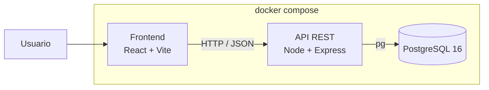
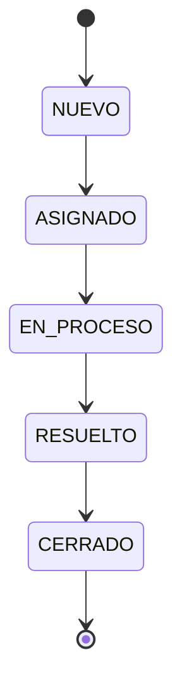

# Arquitectura

TecniSoporte son tres piezas: una aplicación React que corre en el navegador, una API REST en Node con Express, y PostgreSQL guardando los datos. Nada más. La arquitectura es simple a propósito, porque lo que se califica es el proceso DevOps, no la complejidad de la solución.

## Las piezas

**Frontend.** React con Vite. Se comunica con la API por HTTP mandando y recibiendo JSON. No habla con la base de datos ni tiene lógica de negocio: solo muestra, captura y valida lo básico de los formularios.

**API REST.** Node con Express. Aquí vive toda la lógica: las validaciones de verdad, la máquina de estados de los incidentes y el acceso a la base. Está organizada en capas simples, con las rutas separadas del acceso a datos.

La decisión que más me importa de esta capa es que las transiciones de estado estén en un módulo aparte, sin depender de Express ni de la base de datos. Así puedo probarlas con pruebas unitarias sin levantar nada.

**Base de datos.** PostgreSQL 16 en contenedor. Cuatro tablas: `incidents`, `technicians`, `users` y `comments`. Los comentarios van en su propia tabla referenciando al incidente, para que la bitácora sea un historial de verdad y no un campo de texto que se va sobrescribiendo.

## Estados de un incidente

Un incidente solo puede moverse hacia adelante por este camino:

Cualquier otro salto se rechaza en la API. Esta es la regla de negocio central del sistema y por eso es la primera que cubro con pruebas.

## Cómo se levanta

Todo el stack se levanta con un solo `docker compose up`: base de datos, API y frontend. La idea es que cualquiera pueda clonar el repo, copiar el `.env.example` a `.env` y tener el sistema corriendo sin instalar Node ni Postgres a mano.

Esto además me sirve para la estrategia de release de la semana 3, porque el "deploy" a cada ambiente puede ser levantar el stack con Docker a partir del artefacto publicado, sin necesidad de desplegar en la nube.

El frontend se construye en dos etapas: una con node que compila, y otra con nginx que solo sirve los archivos ya compilados. La imagen final no carga con node ni con node_modules. Una cosa que hay que tener presente es que Vite incrusta las variables `VITE_*` en el bundle en tiempo de build, no de arranque, así que la URL de la API entra como argumento del build y cambiarla obliga a reconstruir la imagen.

Los puertos publicados son 5435 para Postgres, 3100 para la API y 5173 para el frontend. No son los de por defecto porque en la máquina de desarrollo hay otros proyectos ocupando el 5432 y el 3000.

## Configuración y secretos

Ninguna credencial vive en el repositorio. La aplicación lee todo de variables de entorno, y el repo solo versiona el `.env.example` con los nombres de las variables y valores de relleno.

En local esas variables salen del `.env`, que está en el `.gitignore` desde el primer commit. En el pipeline salen de un Variable Group de Azure DevOps con los valores marcados como secretos.

## Lo que no hice y por qué

No hay autenticación de usuarios. El PDF pide un campo de usuario en el incidente, pero no un sistema de login, y meterlo habría consumido tiempo que necesito para la parte de DevOps.

Tampoco hay ORM. Uso `pg` directamente con consultas parametrizadas. Para cuatro tablas, un ORM es más configuración que beneficio.
